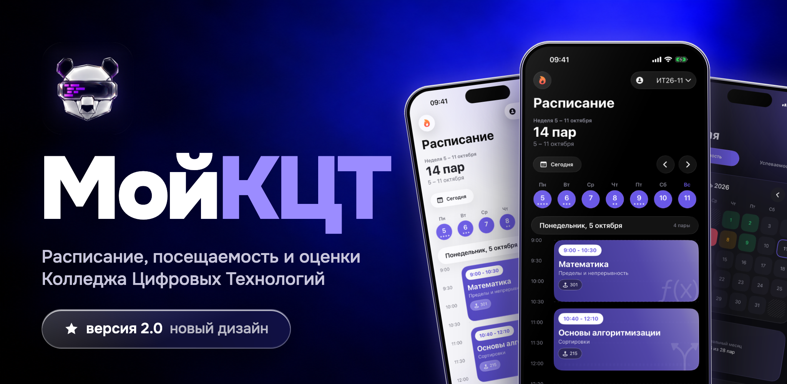

# МойКЦТ

**Расписание, посещаемость и оценки Колледжа Цифровых Технологий - в одном приложении**

---

## Что умеет

| | |
|---|---|
| **Расписание** | Неделя целиком, три дня или один - на выбор. Пары нарисованы на временной сетке: высота карточки равна длительности, идущая пара подсвечена и показывает, сколько осталось |
| **Своя группа** | Группа, подгруппа, профиль и английская группа - расписание сразу подстраивается под конкретного студента |
| **Детали пары** | Тема, преподаватель, кабинет и подгруппы - по нажатию на карточку |
| **Посещаемость** | Календарь месяца с отметками по дням: был, уважительная, неуважительная |
| **Стрик** | Сколько дней подряд без пропусков - прямо в шапке расписания |
| **Успеваемость** | Оценки по каждой работе и средний балл по предмету |
| **Рейтинг** | Место на курсе, вместо имён - случайные псевдонимы |
| **Виджеты** | Текущая и следующая пара на домашнем экране, работают без запуска приложения |
| **Apple Watch** | Расписание на запястье и расширения на циферблате, снимок приходит с iPhone |
| **Темы** | Светлая, тёмная и системная. Свой шрифт, свои иконки предметов, Liquid Glass на iOS 26 |

## Стек

- **Swift 6** + **SwiftUI** + **Observation**, строгая конкурентность, `MainActor` по умолчанию
- **MVVM** без DI-контейнеров: зависимости собираются руками в `AppDependencies`
- **Alamofire** для сети, обновление токенов - single-flight в `actor`
- **WidgetKit** и **WatchConnectivity** для виджетов и часов
- **Firebase Crashlytics** и **MetricKit** для отчётов о сбоях
- Юнит-тесты на **Swift Testing**, зависимости подменяются протокольными фейками

 
<a href="https://anton1ks96.github.io/mykct-ios-app/">Сайт</a> · <a href="https://anton1ks96.github.io/mykct-ios-app/privacy.html">Конфиденциальность</a>
  
Сделано для студентов КЦТ

